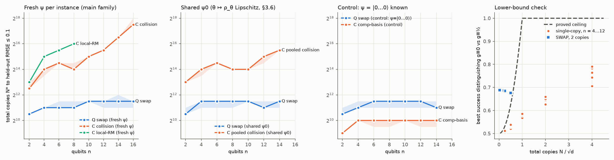

# Τhe Empty cell 

My position paper ("Quantum Advantage for AI Agents: Can Learning Across Instances
Amplify a Coherent-Acquisition Advantage?") guesses that quantum memory helps an agent measure one system, but never gives it
a big edge when it has to generalise to new systems it hasn't seen. This repo tries to break that guess.

Short version: I found a task where the guess fails. An agent with two-copy quantum memory needs about the same
number of copies at every system size. Any agent that measures one copy at a time needs at least about 2^(n/2).
The proofs are in `docs/THEORY.md`. They are still a draft and haven't been checked line by line yet.

## The task

A source has a dial θ between 0 and 1. At each setting it gives out a noisy n-qubit state:

    ρ = (1 - g(θ)) |ψ⟩⟨ψ| + g(θ) I/d

The noise curve g is unknown. ψ is a random state that changes every time you draw a new sample from the source.
The agent gets to measure some samples. After that it has to predict the purity Tr ρ² at any dial setting, for
samples it never measured.

Two kinds of agent:

- **Quantum agent.** Holds two copies of a sample at once and runs a SWAP test. That reads the purity directly.
  Then it fits a simple histogram over θ.
- **Classical agents.** Measure one copy at a time and only keep the results. Because ψ is random, a single copy
  looks like pure noise. You only learn something when two copies of the same sample give the same outcome, and
  that needs about √d copies.

I also ran a version where ψ is the same for every sample, and a control where ψ = |0...0⟩ is known. In the
control there should be no gap.

## Results

Copies needed until the error on unseen samples is at most 0.1, in 90% of 200 runs (seed 20261026). Each agent's
settings were tuned first. Only the classical agents have settings worth tuning, so this helps them.

| qubits n | 2 | 4 | 6 | 8 | 10 | 12 | 14 | 16 |
|---|---|---|---|---|---|---|---|---|
| quantum (SWAP) | 1,448 | 2,048 | 2,048 | 2,048 | 2,896 | 2,896 | 2,896 | 2,896 |
| best classical | 5,792 | 16,384 | 23,170 | 16,384 | 32,768 | 46,340 | 92,682 | 185,364 |
| classical, local random bases | 8,192 | 32,768 | 46,340 | 65,536 | | | | |
| how many times more the best classical needs | 4 | 8 | 11 | 8 | 11 | 16 | 32 | 64 |



What I take from it:

- The quantum agent stays flat. The best classical agent keeps growing, and from n = 12 to 16 it doubles every 2
  qubits, which is the 2^(n/2) the proof predicts.
- With the same ψ for every sample the gap is smaller but still there (16 times at n = 14).
- In the control both stay flat and the classical agent is actually cheaper. So the setup doesn't make up gaps.
- In a small test game no classical strategy ever beat the proven limit, while the SWAP agent did with 2 copies.

What it doesn't show: the proven classical limit is loose. It only beats the quantum agent's real cost from about
n = 24. So up to n = 16 the gap is against the best classical agents I know, not against every possible one.

## How this fits with other work

Huang, Kueng and Preskill (arXiv:2101.02464, Theorem 1) proved there's no exponential gap like this when the
target is linear in ρ, like an expectation value. Purity is quadratic in ρ, which is why it gets through. So the
real line seems to be linear vs nonlinear targets.

There's no real dataset for this. Nobody can yet load an outside quantum system into quantum memory well enough
(section 6.4 of the paper). A run on today's quantum computers would work with states made on the chip.

## Files

    emptycell/cell.py           the task, the agents and the learner
    tests/test_cell.py          17 tests
    scripts/mutation_check.py   breaks the code on purpose to check the tests notice
    scripts/run_inheritance.py  runs everything and writes results/
    docs/THEORY.md              the proofs
    docs/REVIEW.md              what a tough review found and what I changed

## Running it

```bash
pip install -r requirements.txt
```

```bash
pytest tests -q
```

```bash
python scripts/mutation_check.py
```

```bash
python scripts/run_inheritance.py --quick
```

The full run takes about 40 minutes on 16 cores. `--replot 20261026` redraws the figure from the saved CSVs.
